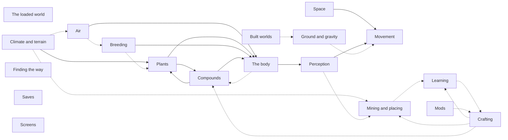

# What caapi does

Written by `caapi-headless wiki` (caapi 0.0.1) from a run of the behavior tests. Each statement in bold is a law that a test checked in that run, and the table under it holds what the run measured. Lengths are in units of the curvature radius of the space, and times are in seconds.

Each section has three kinds of text, and they are not equally sure:

- **Bold** statements are laws a test checked in this run, with what it measured.
- *How it works* and the reference tables are read from the source and the content of this version. No test checks them, so they are what the code says, not what a run showed.
- *Not yet a law* lists behavior that the code has, or that a test only checks along the way, but that no claim states. Each line is a candidate for a new claim.

All 71 laws held, in 133 checks.

## Map

Solid arrows are laws a test checked: one system acting on another. Dotted arrows are dependencies read from the code that no test states yet.

| System | Laws | Acts on | Acted on by |
| --- | --- | --- | --- |
| [Space](#space) | 4 | [Movement](#movement) |  |
| [Ground and gravity](#ground-and-gravity) | 2 |  |  |
| [Movement](#movement) | 8 |  | [Space](#space), [Perception](#perception) |
| [The loaded world](#the-loaded-world) | 2 |  |  |
| [Built worlds](#built-worlds) | 3 |  |  |
| [Climate and terrain](#climate-and-terrain) | 1 | [Plants](#plants) |  |
| [Air](#air) | 1 | [The body](#the-body) |  |
| [Mining and placing](#mining-and-placing) | 8 |  |  |
| [Crafting](#crafting) | 4 |  |  |
| [Learning](#learning) | 2 |  |  |
| [Plants](#plants) | 7 | [Compounds](#compounds), [The body](#the-body) | [Climate and terrain](#climate-and-terrain), [Compounds](#compounds) |
| [Breeding](#breeding) | 2 | [The body](#the-body) |  |
| [Compounds](#compounds) | 5 | [Plants](#plants), [The body](#the-body) | [Plants](#plants) |
| [The body](#the-body) | 2 | [Perception](#perception) | [Air](#air), [Plants](#plants), [Breeding](#breeding), [Compounds](#compounds) |
| [Perception](#perception) | 7 | [Movement](#movement) | [The body](#the-body) |
| [Finding the way](#finding-the-way) | 7 |  |  |
| [Saves](#saves) | 5 |  |  |
| [Screens](#screens) | 0 |  |  |
| [Mods](#mods) | 1 |  |  |

## Space

### How it works

Space is hyperbolic 3-space, tiled by right-angled dodecahedra: twelve faces and twenty corners each, with a right angle between every two faces that meet. Each cell of the honeycomb is cut into twenty cube chunks, one per corner, and each chunk is a grid of 12 x 12 x 12 voxels. The voxels are not evenly spaced: a chunk's grid is spaced geometrically, so a block is not the same size everywhere in it.

Nothing has global coordinates. A place is a cell and a position inside it. Walking through a face moves you into the neighboring cell, and anything that remembers a direction across cells carries it through the faces in between. Carried around a loop, a direction comes back turned, which is what the five-leg walk below measures.

The space grows exponentially. The number of cells within a few steps of you rises steeply with each step, so there is always more room further out, and every system that reaches outward has a fixed reach or budget.

### Laws

**Each further step through the honeycomb more than doubles the number of cells within reach.**

| Test | steps | cells within them | cells within one step fewer | growth |
| --- | --- | --- | --- | --- |
| `demo/growth` | 2 | 115 | 13 | 8.846 |
| `demo/growth` | 3 | 927 | 115 | 8.061 |
| `demo/growth` | 4 | 5158 | 927 | 5.564 |
| `demo/growth` | 5 | 15561 | 5158 | 3.017 |

**A walk of five equal legs with a right turn after each ends where it began. In flat space it would take four.**

| Test | leg length | ended this far from its start |
| --- | --- | --- |
| `demo/holonomy` | 1.061 | 0.01038 |

**After those five legs and five right turns, a turn and a quarter in all, the walker faces the way it first faced.**

| Test | facing off its first direction (degrees) |
| --- | --- |
| `demo/holonomy` | 0.7504 |

### Space: acts on

[Movement](#movement): **A body launched level at speed v at height h over flat ground falls slower than one dropped from rest: after a time t its downward speed is less by v^2 tanh(h) t.**

| Test | speed | height | seconds | fell slower by | predicted |
| --- | --- | --- | --- | --- | --- |
| `flat/curve` | 0.4 | 0.998 | 0.25 | 0.03341 | 0.03043 |

### Not yet a law

- A chunk is 12 voxels on a side, and a cell holds twenty chunks.
- The growth law is checked in the city. Nothing checks that it holds in the terrain world too.

## Ground and gravity

### How it works

The ground is a hyperbolic plane. The code calls such planes horospheres, but they are geodesic planes, and gravity pulls toward whichever ground is nearest. The terrain world and most built worlds have one ground at the bottom. Some worlds raise further grounds above it, and connectors join them with stairs and buildings (see [Built worlds](#built-worlds)). As you climb from one ground toward another, the direction of the pull turns gradually from one to the other.

The surface at a fixed height above a plane is not itself a plane, it curves away. That is why a body moving fast at height falls more slowly than one at rest (the law under [Space](#space)).

`--worldgen plane <degrees>` tilts the base ground by the given angle, and the player then spawns facing uphill. The lattice world turns gravity around, so you stand on the far side of its plane.

Gravity's strength is 1.6, in units of the curvature radius per second squared. Perception can scale it (see [Perception](#perception)).

In creative mode T throws the held block. It leaves at 1.4 forward and 0.5 upward, falls under gravity, and stops as soon as it touches a solid block. At most eight thrown blocks exist at once, and each disappears after 20 seconds or when its cell is unloaded.

### Laws

**A thrown block falls and comes to rest where it hits something solid.** Checked by `demo/throw`.

**On the way up to a risen ground and back down, the pull of gravity changes gradually and never jumps.**

| Test | largest change in one step | rose |
| --- | --- | --- |
| `structure/tripcity` | 0.08258 | 1.999 |
| `structure/tripwild` | 0.07794 | 2.057 |
| `structure/triprooms` | 0.08258 | 2.114 |
| `structure/tripstacked` | 0.08221 | 2.174 |
| `structure/tripcities` | 0.08222 | 1.94 |
| `structure/tripwildwild` | 0.07794 | 2.057 |
| `structure/tripspiral` | 0.07794 | 2.057 |
| `structure/tripdrift` | 0.08258 | 2.114 |
| `structure/triplantern` | 0.08222 | 1.94 |

### Not yet a law

- Gravity pulls toward the nearest ground. The round trips check that the pull changes smoothly, but not which way it points.
- The lattice inverts gravity. `structure/lattice` checks that a jump moves away from the platform and lands back on it, using `check`, not a claim.
- On a tilted plane the player spawns facing uphill.
- A thrown block disappears after 20 seconds, and at most eight exist at once.

## Movement

### How it works

The body is a capsule. It walks, it flies (creative, V) or it passes through everything (noclip, creative, N). Its settings:

| Setting | Value |
| --- | --- |
| walk speed | 0.225 |
| fly speed | 0.4 |
| noclip speed | 0.6 |
| gravity | 1.6 |
| jump height | 0.085 |
| step height | 1 block |
| foot friction | 1.75 |
| body radius | 0.0125 |
| body height | 0.09 |
| eye height | 0.075 |

Values derived from those settings:

- A jump leaves the ground at sqrt(2 x gravity x jump height) = sqrt(2 x 1.6 x 0.085), about 0.52.
- Ground holds the body up while its slope is less than atan(foot friction) = atan(1.75), about 60 degrees. Steeper ground is a wall.

Movement is computed in closed form for each step, so one long step and many short ones end in the same place. Perception scales the walk speed, the gravity and the jump height (see [Perception](#perception)).

### Laws

**Pushing into a corner does not move the body.**

| Test | moved | seconds pushing |
| --- | --- | --- |
| `flat/corner` | 2.611e-05 | 2 |

**A standing jump rises to the body's jump height.**

| Test | rose | expected | jump height setting |
| --- | --- | --- | --- |
| `flat/jump` | 0.08497 | 0.085 | 0.085 |

**A standing jump does not drift sideways.**

| Test | fastest sideways speed |
| --- | --- |
| `flat/jump` | 3.068e-07 |

**The body walks up a step one block high without leaving the ground.**

| Test | steps spent off the ground |
| --- | --- |
| `flat/stair` | 0 |

**Walking covers the same distance whether time advances in long steps or in short ones.**

| Test | walked in long steps | long step (seconds) | walked in short steps | short step (seconds) |
| --- | --- | --- | --- | --- |
| `flat/timestep` | 0.4321 | 0.5 | 0.432 | 0.016 |

**On level ground the body walks at its walk speed whichever way it faces.**

| Test | heading (degrees) | walked | expected | walk speed setting |
| --- | --- | --- | --- | --- |
| `flat/walk` | 0 | 0.6742 | 0.675 | 0.225 |
| `flat/walk` | 90 | 0.6741 | 0.675 | 0.225 |
| `flat/walk` | 180 | 0.6742 | 0.675 | 0.225 |
| `flat/walk` | 270 | 0.6742 | 0.675 | 0.225 |

**On the ground the body never moves faster than its walk speed, or than the speed it landed with.**

| Test | largest excess | at second |
| --- | --- | --- |
| `flat/walk` | 2.98e-08 | 17.41 |
| `flat/wall` | 0 | 0 |
| `slope/across` | 0 | 0 |
| `slope/downhill` | 0 | 0 |
| `slope/hopping` | 0 | 0 |
| `slope/steep` | 0 | 0 |
| `slope/turning` | 0 | 0 |
| `slope/uphill` | 0 | 0 |
| `slope/wall` | 0 | 0 |
| `slope/wall` | 0 | 0 |
| `slope/wall` | 0 | 0 |
| `slope/wall` | 0 | 0 |

8 more checks of this law held. `caapi-headless claims` lists every check.

**The body cannot walk up a wall two blocks high.**

| Test | climbed |
| --- | --- |
| `flat/wall` | 5.141e-07 |

### Movement: acted on by

- [Space](#space): A body launched level at speed v at height h over flat ground falls slower than one dropped from rest: after a time t its downward speed is less by v^2 tanh(h) t.
- [Perception](#perception): Blocks that a dose reveals are solid: the body can climb a stair made of them.
- [Perception](#perception): A stair of hidden blocks can be climbed while perception reveals them.
- [Perception](#perception): Hidden blocks that are revealed while the body is inside them stay passable.
- [Perception](#perception): Revealed hidden blocks turn solid once the body is no longer inside them.
- [Perception](#perception): Hidden blocks that are not revealed do not hold the body up.
- [Perception](#perception): Perception that lowers the jump height lowers the jump by as much.
- [Perception](#perception): Perception that lowers the walk speed slows the walk by as much.

### Not yet a law

- The body squeezes through a hole two blocks high and one wide (`flat/hole`, by `check`).
- Stepping up a block never moves faster than half again the walk speed (`flat/stepover`, by `check`).
- Walking up a 25 degree slope climbs, and a 40 degree slope can still be climbed (`slope/uphill`, `slope/steep`, by `check`). No test walks against ground steeper than the 60 degree limit.
- Fly and noclip move at their set speeds (`live/fly` checks at least 90 percent of them each second, by `check`).
- A falling body that lands from one long 2 second step ends standing (`flat/timestep`, by `check`).

## The loaded world

### How it works

The honeycomb is endless and is built lazily as you move. Each cell has a fixed identity derived from the path to it, so a cell reached by any route is the same cell. Cells and chunks far from you are dropped to save memory, and made again when you come back.

Everything generated is a function of the cell's identity, the world and the content, never of the order of visits or of time. So a dropped cell comes back exactly as it was. What the player changes is kept apart from generation, as a record of edits, and laid back over the cell when it is made again.

Chunks are generated in the background under a budget per frame. `reach` in `caapi.cfg` (0.5 by default) is how far you can reach to mine and place.

### Laws

**However far the player flies, cells are drawn where they are.**

| Test | flown | largest offset |
| --- | --- | --- |
| `live/drift` | 1 | 0.0001243 |
| `live/drift` | 2 | 0.0002443 |
| `live/drift` | 3 | 0.0001993 |
| `live/drift` | 4 | 0.0001295 |
| `live/drift` | 5 | 0.0002681 |
| `live/drift` | 6 | 0.0001604 |

**A block the player placed is still there after its cell was dropped and made again.**

| Test | placed | found afterwards |
| --- | --- | --- |
| `live/edit-kept` | `base:wood-planks` | `base:wood-planks` |

### Not yet a law

- Flying at full speed for 40 seconds, and in noclip for 30, the chunks right around the body are always loaded (`live/fly`, by `check`).
- Flying 32 units out from the root, there is always ground below within reach and the altitude does not drift (`live/far`, by `check`).
- A dropped cell is made again identically. `world-digest`, `check-repaint` and `check-forget` check this outside the behavior tests, so it never reaches this page.

## Built worlds

### How it works

Every world is a plugin. `--worldgen structure <name>` picks one, `--worldgen terrain` is the planet, and the in-game menu lists them all. A world is a program that walks the honeycomb like a turtle and paints boxes of blocks. It can queue further structures that run as the world grows outward, and it can register tile callbacks that paint every cell of a ground. It also names an entrance where the player spawns, and a route of stops that the tests walk on foot.

| World | What it is |
| --- | --- |
| `planet` | The terrain world, also `--worldgen terrain`. It has climate, soil, rock, ores, trees and wild plants (see [Climate and terrain](#climate-and-terrain)), a road, and grounds that rise above it. Other mods' landmarks are placed in up to three rings around the start, on flattened ground, and the player spawns by a giant tree. |
| `city` | Endless city blocks on a city ground: basalt roads, concrete sidewalks, parks, ponds and plazas. Each block is zoned into lots, and each lot gets one of eight building types (below). |
| `backrooms` | Endless rooms on three levels. Offices have wallpaper, carpet and light panels, some sodden or stained. Houses have plaster, wood, parlors, studies and attics. Mazes are bunkers, cellars and sumps in concrete and brick. Stairs join the levels. |
| `library` | An endless library: galleries, double-height halls and stairwells lined with shelves of books. Sunken stacks are wells with a spiral stair and floors of glass, and they go down without end. Fogged. |
| `arbor` | A giant tree with a spiral stair climbing its trunk, and a deck with lanterns every third segment. |
| `babel` | A square tower of a central core with a stair winding round it, rising from a plaza. |
| `caves` | A sinkhole whose spiral stair leads into a branching cave system. The deeper you go, the more the caves change: frost and icicles, then dripstone and pillars, then gypsum chandeliers, then crystal beams, then basalt columns. They reach about five edges down. Fogged. |
| `crown` | Four towers on the corners of one face, joined at their foot by halls and higher up by arched bridges, with balconies. |
| `lattice` | An endless lattice of poles and girders along the edges of the honeycomb, with platforms, spiral stairs round some poles, lanterns, clumps of leaves and huts. Gravity is inverted. Fogged. |
| `palace` | Halls sunk below a lawn, with windows in the outer walls, lamps hung from rods, grand stairs down from the lawn, and a fountain at the centre. |
| `road` | A viaduct: a striped road with parapets on masonry arches, standing on piers that reach down eight edges. |
| `tower` | A tower three edges high with a stair inside. |
| `trail` | An endless gravel trail that winds across the ground, with a hut beside about one segment in three. |
| `vaults` | Endless domed halls. Their walls have doors, arcades and niches, a stair climbs to a gallery, the vaults above are stepped and ribbed with lamps in them, and some halls have a spire at the centre. Fogged. |

`arbor`, `babel`, `crown`, `palace`, `tower` and `trail` are also landmarks the planet can place. `arbor`, `babel`, `library` and the library's stacks are also kinds of ground that can rise. The `fixtures` mod adds small worlds for the tests: risen grounds of each kind, every connector style, round trips, a chain of two risen cities, the stairs between backrooms levels, a showcase of buildings and a hamlet of five huts.

**Risen grounds.** Some worlds raise further grounds above the first. The planet raises a ground with odds 0.015 and a giant tree with odds 0.002 (its `settings.conf`). A risen ground is wild terrain, a city or backrooms, and mods add more kinds, such as the library. A connector building joins it to the ground below. A connector has one of four styles, drawn with weights that depend on the pair of grounds (`connector.content`):

| Lower to upper | tower | spiral | drift | lantern |
| --- | --- | --- | --- | --- |
| wild to wild | 39 | 44 | 11 | 6 |
| wild to city | 64 | 26 | 5 | 5 |
| wild to backrooms | 25 | 12 | 25 | 38 |
| wild to library | 28 | 39 | 17 | 16 |
| city to wild | 44 | 44 | 6 | 6 |
| city to city | 67 | 22 | 5 | 6 |
| city to backrooms | 53 | 0 | 20 | 27 |
| city to library | 53 | 18 | 12 | 17 |
| backrooms to wild | 17 | 17 | 33 | 33 |
| backrooms to city | 60 | 0 | 20 | 20 |
| backrooms to backrooms | 57 | 0 | 21 | 22 |
| backrooms to library | 50 | 10 | 20 | 20 |
| library to wild | 29 | 36 | 21 | 14 |
| library to city | 55 | 20 | 10 | 15 |
| library to backrooms | 50 | 0 | 25 | 25 |
| library to library | 50 | 28 | 6 | 16 |

A fifth style, hidden, is built of mist stone that only shows to an altered eye (see [Perception](#perception)). The base content draws it with no weight, and only the `hiddenstair` test world uses it.

**City buildings.** Lots take these building types, each with its range of stories and several palettes:

| Type | Stories |
| --- | --- |
| rowhouse | 2 to 3 |
| warehouse | 2 to 4 |
| civic | 3 to 6 |
| brownstone | 4 to 5 |
| tenement | 5 to 9 |
| modern | 6 to 20 |
| glass | 12 to 38 |
| deco | 14 to 34 |

### Laws

**The stair route through the structure can be walked on foot from its first stop to its last.**

| Test | stops reached | climbed |
| --- | --- | --- |
| `structure/arbor` | 97 | 4.295 |
| `structure/arch` | 100 | 2.122 |
| `structure/babel` | 33 | 1.424 |
| `structure/backroomsbasement` | 13 | 0.2962 |
| `structure/backroomsstairs` | 14 | 0.4322 |
| `structure/palace` | 14 | 0.5155 |
| `structure/stairs` | 126 | 3.183 |
| `structure/vaults` | 17 | 0.5391 |

**Flying over the city there is always city below, and never bare ground.**

| Test | flown | below |
| --- | --- | --- |
| `structure/endless` | 0.5 | `base:white-brick` |
| `structure/endless` | 1 | `base:basalt` |
| `structure/endless` | 1.5 | `base:basalt` |
| `structure/endless` | 2 | `base:basalt` |
| `structure/endless` | 2.5 | `base:basalt` |
| `structure/endless` | 3 | `base:concrete` |
| `structure/endless` | 3.5 | `base:concrete` |
| `structure/endless` | 4 | `base:wood-planks` |
| `structure/endless` | 4.5 | `base:wood-planks` |
| `structure/endless` | 5 | `base:concrete` |

**A connector's route leads on foot from the lower ground up onto the risen one.**

| Test | ended this high |
| --- | --- |
| `structure/risen` | 2.048 |
| `structure/spiral` | 2.048 |
| `structure/drift` | 2.048 |
| `structure/lantern` | 2.048 |
| `structure/stacked` | 2.048 |
| `structure/stackedrooms` | 2.162 |
| `structure/wild` | 2.105 |

### Not yet a law

Each of these is checked by a test with `check`, and none is stated as a law:

- The city spawns you on the street, and its route climbs two stories of stairs into a building (`structure/city`).
- The library's spiral stair goes down at least 20 units, its floor stays level all the way down, and there is a glass floor over the well at every depth tried, down to 40 (`structure/library`, `structure/librarylive`, `structure/libraryendless`, `structure/libraryflight`). Dropped anywhere in the well, you land within half a unit (`structure/librarynohole`).
- The arbor's trunk goes on at every height tried, up to 40 (`structure/arborendless`). A tree trunk in the terrain world can be climbed beside its bark to 3.2 (`structure/treetrunk`).
- The caves' route goes down at least 0.9 into the sinkhole and comes back up to the rim (`structure/caves`).
- The lattice spawns you on a platform (`structure/lattice`).
- The backrooms spawn you between their floor and ceiling (`structure/backroomsworld`), and a risen backrooms can be climbed into (`structure/backrooms`).
- A chain of two risen cities can be climbed from the first to the second (`structure/chain`).
- The trail keeps growing as the world grows, and it winds rather than running straight (`structure/trail`).
- The road, the tower, the crown's hall and every hut of the hamlet can be walked onto (`structure/road`, `structure/tower`, `structure/crown`, `structure/hamlet`).
- A tower has a floor within reach at every height (`structure/axis`).

## Climate and terrain

### How it works

Each cell of the terrain world has a climate. It inherits the mean climate of the cells it was reached from, keeps most of it and adds a little noise. So climate drifts smoothly across the world, and regions form without any map. Six quantities drift this way:

| Quantity | Kept from the parents | Noise added |
| --- | --- | --- |
| broad relief | 0.92 | 0.25 |
| local relief | 0.5 | 0.25 |
| heat | 0.94 | 0.3 |
| wetness | 0.94 | 0.3 |
| strata | 0.8 | 0.25 |
| ruggedness | 0.9 | 0.2 |

- The height of the land, its relief, is broad relief plus local relief plus mountains. Mountains are 2.5 times whatever ruggedness exceeds 0.4. Land is flattened where a world asks for it, such as under the planet's landmarks.
- Warmth is heat minus 0.3 times relief, so high ground is colder.
- Below altitude -0.6 the open air fills with water, or with ice where warmth is under -0.45.

**Layers.** The top 0.06 of the ground is cover, down to 0.4 is soil, and below that is rock. Cover and soil are picked by the first rule whose bounds the climate meets:

| Cover | When |
| --- | --- |
| snow | warmth below -0.45 |
| andesite | relief above 2.2 |
| gravel | relief below -1.1 (lake beds) |
| sand | relief below -0.52 (shores) |
| gravel | warmth below -0.15, wetness below -0.2 |
| coarse grass | warmth below -0.15 |
| red sand | warmth above 0.45, wetness below -0.65 |
| sand | warmth above 0.45, wetness below -0.35 |
| mud | warmth above 0.1, wetness above 0.75 |
| lush grass | warmth above 0.1, wetness above 0.45 |
| mud grass | wetness above 0.45 |
| tan grass | warmth above 0.25, wetness below -0.05 |
| grass | anywhere else |

| Soil | When |
| --- | --- |
| andesite | relief above 2.2 |
| sand | relief below -0.52 |
| red sand | warmth above 0.45, wetness below -0.65 |
| sand | warmth above 0.45, wetness below -0.35 |
| clay | wetness above 0.5 |
| clay loam | wetness above 0.2 |
| dirt | wetness above -0.1 |
| sandy loam | anywhere else |

Rock comes in four bands by depth below the surface, shifted by the cell's strata. Within a band the stone depends on wetness (below -0.2, up to 0.3, above) and on warmth (below or above 0.35):

| Band | Depth | Dry | Middling | Wet |
| --- | --- | --- | --- | --- |
| 0 | 0.4 to 1.2 | sandstone, or red sandstone when warm | shale | limestone |
| 1 | 1.2 to 2.6 | slate | dolomite, or marble when warm | marble |
| 2 | 2.6 to 4.5 | granite | diorite | andesite |
| 3 | below 4.5 | gabbro, or olivine when warm | basalt | gabbro |

**Ores.** A chunk has odds 0.08 of holding a vein, a ball of radius 2 voxels that turns 70 percent of the rock it covers to ore. Each ore forms only in certain rocks, so each is found at its own depth:

| Ore | Forms in | So look in band |
| --- | --- | --- |
| sulfur | limestone, dolomite, shale, sandstone, red sandstone | 0, and dolomite in 1 |
| copper ore | marble, slate | 1 |
| iron ore | granite, diorite, andesite, gabbro, basalt, olivine | 2 and 3 |

**Trees.** Trees are tried in each chunk, more of them where it is wet: the share of candidate spots is 0.05 plus wetness / 4, kept between 0.01 and 0.3. A tree grows only on the ground it takes to. The first rule the climate meets picks the species:

| Climate | Trees |
| --- | --- |
| warmth above 0.45, wetness below -0.35 | cactus |
| warmth below -0.45 | bare snags (one in three), else spruce |
| warmth below -0.2 | birch (one in six), else spruce |
| anywhere | one in eight is a shrub |
| warmth above 0.25, wetness above 0.45 | big oak (one in three), else jungle |
| warmth above 0.25, wetness below -0.05 | acacia |
| wetness above 0.45 | willow, big oak, oak, giant mushroom |
| warmth below 0.05 | maple, birch, oak, giant mushroom |
| anywhere else | oak, birch, big oak, cherry, maple, giant flower |

Wild plants are tried in 2 percent of each chunk's spots, and the climate picks the species (see [Plants](#plants)).

### Climate and terrain: acts on

[Plants](#plants): **A ripe plant yields one of itself and up to two more, in proportion to how well the climate suits it.**

| Test | how well the climate suits it (0 to 1) | yielded | predicted |
| --- | --- | --- | --- |
| `gene/ripening` | 0.8666 | 3 | 3 |

### Not yet a law

No test checks any of the above. Candidates that a test could predict from the model:

- Land below -0.6 is under water, or ice where it is cold enough.
- The cover, soil and rock found at a spot match the rule tables for its climate and depth.
- Ore is found only in the rocks it forms in.
- Climate changes little from a cell to its neighbors.

## Air

### How it works

The air of a place holds three gases, each at a level from 0 to 1 set by the local climate (sigma(x) = 1 / (1 + e^(-x))):

| Gas | Level |
| --- | --- |
| mire | sigma(3 x (wetness + heat)) |
| frost | sigma(-3 x warmth) |
| ash | sigma(3 x (relief - 1 + strata)) |

A collector, made at the anvil, fills with the local air from the moment it is placed. It gathers each gas at its level times 0.02 per second, for at most 120 seconds. Use it to open it and breathe the air in: every gas goes into the body as an inhaled dose, and the collector starts filling again.

Ash also matters at the bench: it raises the odds that a cross mutates (see [Breeding](#breeding)).

### Air: acts on

[The body](#the-body): **A collector gathers a gas at its level in the local air times the collection rate, and breathing it in puts that much into the body.**

| Test | seconds collecting | first gas breathed in | predicted |
| --- | --- | --- | --- |
| `plant/collector` | 30 | 0.1865 | 0.1865 |

### Not yet a law

- Breathing the collected air puts all three gases into the body, and breathing again at once adds nothing (`plant/collector`, by `check`).
- A collector stops filling after 120 seconds.

## Mining and placing

### How it works

Hold the mine button on a block to break it. A block takes its break time, divided by 1 + 0.4 x the tier of your best pickaxe, so any pickaxe also speeds up blocks that do not need it. A block that needs a higher tier than yours does not crack however long you hold, and a note says which tool it needs. In creative mode every block breaks in 0.15 seconds.

| Pickaxe | Tier | Made at |
| --- | --- | --- |
| bare hands | 0 |  |
| wooden pickaxe | 1 | workbench |
| stone pickaxe | 2 | workbench |
| copper pickaxe | 3 | anvil |
| iron pickaxe | 4 | anvil |

The base mod's blocks by break time and tier. A block that sets no break time takes 1.5 seconds.

| Break time | Tier | Blocks |
| --- | --- | --- |
| 0.3 | 0 | snow, ice slush, glass, every kind of leaves, mushroom cap, petals, pollen, fern, flower, thornbush, moss |
| 0.7 | 0 | dirt, sand, red sand, silt, clay, mud, the loams, gravel, every kind of grass, water, wallpaper, carpets, ceiling tile, mushroom stem, flower stem |
| 1.5 | 0 | every kind of wood, wood planks, cactus, workbench, press, bench, collector, beacon, the strange stones and lights |
| 1.5 | 1 | furnace, anvil |
| 1.5 | 3 | lab |
| 3 | 1 | ice, every stone, bricks, concrete, wet concrete, plaster |
| 4.5 | 0 | lava, light panel, sunlight |
| 4.5 | 2 | copper ore, sulfur |
| 4.5 | 3 | iron ore |
| 4.5 | 4 | steel |

A broken block goes into the inventory. A living block keeps its genes when it does, and a plant also yields by how ripe it is (see [Plants](#plants)). The right button places the held block in the cell you aim at, unless the cell is taken or the block would overlap your body. Placing a beacon, a collector or a living block also records it, so the game knows the beacon's place, when the collector started filling, and the genes and planting time of the living block.

The inventory is a hotbar of 12 slots and a pack of 36 more, with up to 64 in a stack. When a block or an item will not fit, it is lost and a note says how many.

### Laws

**Breaking a block puts one of it in the inventory.**

| Test | held before | held after |
| --- | --- | --- |
| `flat/items` | 0 | 1 |

**Placing a block takes one of it out of the inventory.**

| Test | held before | held after |
| --- | --- | --- |
| `flat/items` | 999 | 998 |

**Half way through its break time a block is still whole and shows mining progress.**

| Test | break time (seconds) | progress shown |
| --- | --- | --- |
| `flat/mining` | 0.7 | 0.48 |

**Holding mine on a block for its break time breaks it and puts it in the inventory.**

| Test | break time (seconds) | held after |
| --- | --- | --- |
| `flat/mining` | 0.7 | 1 |

**A block that needs a pickaxe cannot be mined by hand, however long the key is held.**

| Test | block | seconds held |
| --- | --- | --- |
| `flat/tiers` | `base:sandstone` | 3.2 |

**A pickaxe shortens a block's break time.**

| Test | block | by hand (seconds) | with a wooden pickaxe (seconds) |
| --- | --- | --- | --- |
| `flat/tiers` | `base:sandstone` | 3 | 2.143 |

**With the pickaxe it needs, a block is mined in its shortened break time.**

| Test | block | seconds held |
| --- | --- | --- |
| `flat/tiers` | `base:sandstone` | 2.343 |

**A block cannot be placed where the body stands.** Checked by `flat/place`.

### Not yet a law

- The pickaxe speedup is 1 + 0.4 x tier. The test measures 3 seconds becoming 2.143 = 3 / 1.4 but does not state the rule.
- Mining sandstone by hand leaves a note saying what it needs (`flat/tiers`, by `check`).
- A block cannot be placed with none held (`flat/items`, by `check`).
- Breaking a beacon removes it from the list of beacons (`beacon/home`, by `check`).
- A full inventory loses what does not fit, with a note.

## Crafting

### How it works

Crafting is a queue of at most 16 steps. Queue a recipe and the recipes that make its missing ingredients are queued ahead of it, up to four levels deep, preferring the recipe that yields the most. If the ingredients cannot be found or made, nothing is queued and a note says what is missing. Only one step works at a time: the first in the queue that can start.

A step takes its ingredients when it starts. Cancel a started step and exactly those ingredients come back. A pickaxe or other tool can be made only once, and queuing a second is refused while the first waits.

Work at the hand needs nothing. Work for a station moves only while you are within 0.6 of a station of that kind that you have opened with the right button, and that is still standing. In creative mode every station counts as near.

Stations: workbench, furnace, anvil, press and lab. The bench and the collector are used by right-clicking too, but they are machines, not stations (see [Breeding](#breeding) and [Air](#air)).

Recipes of the base mod. A group such as "wood" or "stone" accepts any of its members. "Learned by" means the recipe stays hidden until that insight is noticed (see [Learning](#learning)).

| Makes | From | At | Seconds | Learned by |
| --- | --- | --- | --- | --- |
| 4 wood planks | 1 wood | hand | 0.5 |  |
| workbench | 6 planks | hand | 1.5 |  |
| wooden pickaxe | 3 planks | workbench | 1.5 |  |
| stone pickaxe | 2 planks, 3 stone | workbench | 2 |  |
| furnace | 8 stone | workbench | 3 |  |
| press | 4 planks, 2 stone | workbench | 2 |  |
| anvil | 4 stone, 3 copper bars | workbench | 3 |  |
| bench | 4 planks, 2 glass | workbench | 2 |  |
| inhaler | 2 glass, 1 plank | workbench | 1.5 |  |
| sand | 4 sandy soil | workbench | 2 | sifting |
| clay | 4 silty soil | workbench | 2 | sifting |
| furnace | 6 masonry | workbench | 3 | salvage |
| anvil | 4 stone, 1 steel | workbench | 3 | salvage |
| glass | 2 sand | furnace | 1 |  |
| copper bar | 2 copper ore | furnace | 2 |  |
| iron bar | 2 iron ore | furnace | 3 |  |
| grey brick | 2 clay | furnace | 2 |  |
| 2 charcoal | 1 wood | furnace | 2 | charring |
| 2 iron bars | 2 iron ore, 1 charcoal | furnace | 3 | charring |
| 2 copper bars | 2 copper ore, 1 charcoal | furnace | 2 | charring |
| glass | 3 fine soil | furnace | 1.5 | sifting |
| 2 glass | 2 sand, 1 water or ice | furnace | 1 | quenching |
| glass | 1 lava | furnace | 1 | quenching |
| charcoal | 2 cloth | furnace | 1.5 | salvage |
| 2 glass | 1 lamp | furnace | 1 | salvage |
| copper pickaxe | 2 planks, 3 copper bars | anvil | 3 |  |
| iron pickaxe | 2 planks, 3 iron bars | anvil | 4 |  |
| collector | 2 glass, 2 copper bars | anvil | 2 |  |
| beacon | 1 glass, 1 copper bar | anvil | 2 |  |
| lab | 4 iron bars, 4 glass | anvil | 4 |  |
| syringe | 1 glass, 1 iron bar | anvil | 2 |  |
| beacon | 1 lamp, 1 copper bar | anvil | 2 | salvage |
| 2 iron bars | 1 steel | anvil | 2 | salvage |
| assay kit | 2 glass, 2 copper bars | lab | 3 |  |
| 2 oxidizer | 1 sulfur | lab | 1.5 |  |
| 2 conjugant | 2 leaves | lab | 1.5 |  |
| cleaver | 1 iron bar, 1 sulfur | lab | 2 |  |
| polar graft | 2 clay | lab | 1.5 |  |
| charged graft | 1 copper ore | lab | 1.5 |  |
| bulky graft | 2 stone | lab | 1.5 |  |
| bulky graft | 2 gravel or lava | lab | 1.5 |  |
| polar graft | 2 water or ice | lab | 1.5 | quenching |
| bulky graft | 1 masonry | lab | 1 | salvage |
| conjugant | 2 cloth | lab | 1.5 | salvage |
| charged graft | 2 strange stone | lab | 2 | strangeness |
| bulky graft | 2 strange stone | lab | 2 | strangeness |

**The way up.** Wood makes planks, and planks make a workbench. The workbench makes a wooden pickaxe, which mines stone. Stone makes a stone pickaxe and a furnace, and the furnace turns sand into glass. The stone pickaxe mines copper ore, which the furnace smelts. Copper bars and stone make an anvil, and at the anvil a copper pickaxe, which mines iron ore. Iron makes the iron pickaxe, the only tool that mines steel, and iron and glass make the lab.

### Laws

**Queuing a recipe also queues, ahead of it, the recipes that make its missing ingredients.**

| Test | steps queued for a workbench from two wood |
| --- | --- |
| `flat/crafting` | 3 |

**Cancelling a craft that has started gives back exactly the ingredients it took.**

| Test | spruce wood back | oak wood back |
| --- | --- | --- |
| `flat/crafting` | 1 | 0 |

**Work for a station waits while the player has used no station of that kind nearby.**

| Test | crafts still waiting |
| --- | --- |
| `flat/crafting` | 1 |

**Once the player has placed and used the station, the work that waited for it is done.**

| Test | crafts still waiting |
| --- | --- |
| `flat/crafting` | 0 |

### Not yet a law

- Nothing can be made from nothing (`flat/crafting`, by `check`).
- A queued step starts on the next step of the game (`flat/crafting`, by `check`).
- A tool cannot be queued twice (`flat/crafting`, by `check`).
- The queue holds at most 16 steps.
- Walking more than 0.6 away from the station you used pauses its work.

## Learning

### How it works

Some recipes have to be learned first. You learn by noticing an insight, either by breaking one of its blocks or by finishing any work at its station. A note announces it, the journal (J) keeps its text, and the recipes it unlocks become known. In creative mode every insight is known.

| Insight | Noticed by | What the journal says | Unlocks |
| --- | --- | --- | --- |
| charring | finishing work at a furnace | Wood left in the furnace's heat turns to charcoal, and charcoal worked through ore gives back more metal. | charcoal from wood, and iron and copper smelted with charcoal for twice the bars |
| sifting | breaking loam, grass, dirt, gravel, silt or mud | Loam, grass and dirt are sand and clay held together; sifted, they come apart, and the finest of them melts to glass. | sand and clay from soil, glass from fine soil |
| quenching | breaking snow, ice, ice slush or water | Water poured over hot sand sets more glass, lava cools to glass, and melted ice carries a polar graft. | double glass with water, glass from lava, polar graft from water |
| salvage | breaking bricks, concrete, plaster, ceiling tile, wallpaper, carpet, lamps or steel | What others built can be taken apart: masonry crushes to grit, cloth chars or pulps, lamps keep their glass and steel gives back its iron. | furnace from masonry, anvil from steel, charcoal and conjugant from cloth, glass and beacons from lamps, iron from steel, bulky graft from masonry |
| strangeness | breaking a strange stone or light | Blocks that only appear to an altered eye still carry charge and bulk. | charged and bulky grafts from strange stone |

### Laws

**Breaking the right block teaches an insight, and the recipes that need it become known.**

| Test | block broken | insight | recipe |
| --- | --- | --- | --- |
| `flat/learning` | `base:dirt` | `base:sifting` | `base:sift-sand` |

**Finishing work at a station can teach an insight.**

| Test | recipe worked | insight |
| --- | --- | --- |
| `flat/learning` | `base:smelt-glass` | `base:charring` |

### Not yet a law

- An unlearned recipe cannot be queued, even as an ingredient step.
- Noticing an insight a second time posts no note.

## Plants

### How it works

Some blocks are living: every kind of leaves, the mushroom cap, petals, pollen, cactus and the four plants. A living block carries genes, and its genes decide the compound it makes. Four of them are plants, which grow wild in the terrain world and can be planted and harvested:

| Plant | Thrives | Grows on | Grows wild where | Its compound targets |
| --- | --- | --- | --- | --- |
| fern | wet | dirt and grasses | wetness above 0.45 | receptor A, skipping the brake (mist opening) |
| flower | mild | dirt and grasses | anywhere else | receptors A and B, skipping the brake (lifting) |
| thornbush | arid | sand, red sand, dirt and grasses | warmth above 0.45, wetness below -0.35 | receptor A, skipping the trigger (mist closing) |
| moss | cold | dirt, grasses, snow and gravel | warmth below -0.45 | receptor C, skipping the trigger (dulling) |

The cactus and the mushroom cap make a compound shaped for receptor B (swaying), and petals and pollen the same as the flower. Leaves have no shape to aim at: their compound is built from their genes alone. What a compound shaped for a receptor does is under [The body](#the-body).

**Genes.** A living block has four genes. One builds the compound's scaffold, two encode enzymes that change it, and one is kept for form. Each cell of the world inherits its genes from the cells it was reached from, and mutates now and then (odds 0.04 per gene). Species in one cell differ from each other (odds 0.5 per gene), and each wild plant differs from its neighbors in one gene (odds 0.1). So the same plant makes different compounds in different places.

For a species with a target, the compound starts as the shape that fits its receptor, and each part of that shape is lost with odds 0.25. The two enzyme genes then act on it in turn.

**Growing.** Plant one by placing it on its ground. It grows for 60 seconds and is then ripe. Breaking it ripe yields 1 + round(2 x fit) of it, where fit is how well the local climate suits it, from 0 to 1. Breaking it early gives back the one plant. A plant that grew wild gives one. A plant held with no genes of its own, from the catalog, takes this place's genes when it is planted. Other living blocks keep their genes when placed, but do not grow.

Fit is 1 / (1 + e^(-4 s)), where s depends on what the plant thrives in:

| Thrives | s |
| --- | --- |
| arid | warmth - wetness |
| cold | 0.05 - warmth |
| wet | wetness + 0.05 |
| mild | 0.5 - wetness^2 - warmth^2 |

**Identifying.** What a living block makes is unidentified until you hold that compound, or own an assay kit. Unidentified blocks of one species share one stack, each keeping its own genes inside it. When you come to hold a compound, the blocks that make it move to a stack of their own.

**Eating.** Hold F with a living block selected, and after 1.5 seconds you swallow it: one dose of its compound goes into the body (see [The body](#the-body)). Letting go earlier eats nothing. A block with no genes of its own cannot be eaten.

### Laws

**A planted plant reads as growing at first, and as ripe once its growing time has passed.**

| Test | growing time (seconds) |
| --- | --- |
| `gene/grow` | 60 |

**A living block that is placed and broken again comes back with the genes it had.** Checked by `gene/kept`.

**Breaking a plant before it is ripe gives back the one plant with its genes, and nothing more.**

| Test | given back |
| --- | --- |
| `gene/ripening` | 1 |

**Breaking a plant that nobody planted gives one of itself.**

| Test | yielded | a ripe planted one would yield here |
| --- | --- | --- |
| `gene/wild` | 1 | 3 |

**Plants whose compounds the player has not identified share one stack, and each keeps its own genes inside it.**

| Test | stacks held | of the first strain | of the second strain |
| --- | --- | --- | --- |
| `gene/unsorted` | 1 | 2 | 3 |

### Plants: acts on

[Compounds](#compounds): **Pressing a living block yields extract of the compound that its genes make.**

| Test | compounds held | extract expected |
| --- | --- | --- |
| `gene/harvest` | 1 | 1 |

[The body](#the-body): **Eating a living block puts one dose of the compound its genes make into the body.**

| Test | amount in the body | one dose |
| --- | --- | --- |
| `plant/eat` | 1 | 1 |

### Plants: acted on by

- [Climate and terrain](#climate-and-terrain): A ripe plant yields one of itself and up to two more, in proportion to how well the climate suits it.
- [Compounds](#compounds): Once the player holds a compound, the plants that make it leave the unidentified stack for a stack of their own.

### Not yet a law

- Letting go of eat early eats nothing, a block with no genes cannot be eaten, and a block that is not living cannot be eaten (`plant/eat`, by `check`).
- Breaking leaves gives back the leaves with the genes that make their compound (`gene/harvest`, by `check`).
- Cancelling a pressing gives back the same block, genes and all (`gene/harvest`, by `check`).
- A plant that grew wild reads as wild (`gene/wild`, by `check`).
- A plant with no genes takes the place's genes when planted.
- Owning an assay kit identifies every compound at once.

## Breeding

### How it works

The bench is used with the right button. It opens with the first two plants in the inventory marked, and any two can be marked instead.

**Crossing** uses up one of the first marked plant and makes one new plant of its species. Each of its four genes comes from one parent or the other, and each mutates with these odds:

- 0.05 everywhere,
- plus 0.3 times the level of ash in the bench's air (see [Air](#air)),
- plus 0.3 if you hold sulfur, the mutagen, which the cross then uses up.

The bench shows the odds before you cross.

**Splicing** uses up the first marked plant and adds one enzyme to your own genome: the enzyme encoded by the plant's first enzyme gene. Your starting genome holds five genes, three receptor halves and two enzymes, and it can hold sixteen. So you can splice eleven times. Splicing keeps what is already in the body and the state of its signals. What enzymes do is under [The body](#the-body).

### Laws

**A cross takes each of its genes from one of its two parents, apart from the occasional mutation.**

| Test | genes taken from a parent | genes in all |
| --- | --- | --- |
| `gene/breed-splice` | 4 | 4 |

### Breeding: acts on

[The body](#the-body): **Splicing uses up the plant and adds one gene to the player's genome.**

| Test | genes before | genes after |
| --- | --- | --- |
| `gene/breed-splice` | 5 | 6 |

### Not yet a law

- Opening the bench marks the first two plants (`gene/breed-splice`, by `check`).
- A cross turns one of the first plant into the cross, so the count of plants stays the same (`gene/breed-splice`, by `check`).
- The mutation odds: 0.05, more in ash, more with sulfur.
- The genome holds at most sixteen genes, and splicing into a full genome is refused.

## Compounds

### How it works

A compound is a molecule: a 3 x 3 x 3 grid in which each cell is empty or holds a fragment. A fragment has any mix of three properties, bulky, charged and polar, and the whole molecule can also be conjugated. A compound is named by three syllables, a consonant and a vowel each, computed from its shape, except the three gases of the air, which are called mire, frost and ash.

You can hold up to 24 compounds. Each has an amount of extract and a number of doses, and when a 25th arrives the oldest is dropped.

**Extract and doses.** Press a living block at the press to get 1 extract of its compound (2 seconds). Press 4 extract into 1 dose (2 seconds).

**Lab reactions.** Each takes one dose and its reagent and makes one dose of the changed compound. A reaction that would not change the compound is refused, and one waits until its reagent is in the inventory.

| Reaction | Reagent | Seconds | What it does |
| --- | --- | --- | --- |
| oxidize | oxidizer | 3 | turns the polar property of one fragment on or off |
| conjugate | conjugant | 3 | conjugates the molecule, so the body clears it faster |
| cleave | cleaver | 4 | removes one fragment |
| graft polar | polar graft | 4 | adds a polar fragment in an empty cell |
| graft charged | charged graft | 4 | adds a charged fragment in an empty cell |
| graft bulky | bulky graft | 4 | adds a bulky fragment in an empty cell |

A reaction acts on the first cell it finds, looking at the molecule in each of its 24 orientations. So the result is fixed for a given compound, but which cell changes is not something you choose.

**Taking a dose.** A dose goes into the body one of three ways:

| Route | Needs | Goes to | Reaches the blood |
| --- | --- | --- | --- |
| swallow | nothing | the gut | at 0.2 per second |
| inhale | an inhaler, kept | the lungs | at 2 per second |
| inject | a syringe, used up | the blood | at once |

The body holds at most 16 compounds at once. A dose that would need a 17th is refused until one clears.

**Assay.** With an assay kit, every compound you hold and every living block you aim at shows which of your receptors it binds, and whether it drives each one up or down, as "acts on AB+ CC-".

### Laws

**A press turns extract into doses.**

| Test | extract before | doses after | extract after |
| --- | --- | --- | --- |
| `gene/synthesis` | 8 | 2 | 0 |

**A lab reaction waits until its reagent is in the inventory.**

| Test | compounds held | crafts waiting |
| --- | --- | --- |
| `gene/synthesis` | 1 | 1 |

**A dose cannot be taken by a route whose device the player lacks.**

| Test | route |
| --- | --- |
| `gene/synthesis` | `injected` |

### Compounds: acts on

[Plants](#plants): **Once the player holds a compound, the plants that make it leave the unidentified stack for a stack of their own.**

| Test | compounds held | in the identified stack |
| --- | --- | --- |
| `gene/unsorted` | 2 | 2 |

[The body](#the-body): **Taking a dose puts its compound into the body.**

| Test | compounds in the body |
| --- | --- |
| `gene/synthesis` | 1 |

### Compounds: acted on by

- [Plants](#plants): Pressing a living block yields extract of the compound that its genes make.

### Not yet a law

- Once its reagent arrives, a lab reaction makes one dose of the changed compound (`gene/synthesis`, by `check`).
- A reaction that would not change the compound is refused.
- The routes reach the blood at different rates: an injected dose acts at once, an inhaled one within seconds and a swallowed one over many seconds.
- A syringe is used up by an injection, and an inhaler is not.
- At most 24 compounds are held, and at most 16 in the body.

## The body

### How it works

The body is modeled from receptors up to what you feel, in four stages. Every rate below is per second.

**Receptors.** Your genome holds receptor halves, each describing half of a 3 x 3 x 3 pocket: which cells are walls, which are open and want certain properties, which are triggers and which are brakes. Every pair of halves joins into a receptor, a half with itself included, so three halves make six receptors. A receptor's amount is the product of its halves' expressions over their sum, doubled when the halves differ. The starting halves A, B and C have expressions 1, 1 and 0.5, which gives:

| Receptor | Amount |
| --- | --- |
| AB | 0.8 |
| AA, BB, AC, BC | 0.4 each |
| CC | 0.1 |

**Binding.** A compound binds a receptor in whichever of its 24 orientations fits best. In an open cell, each of the three properties on which the fragment agrees with what the cell wants scores 1, and each on which it disagrees costs 2. A fragment in a wall costs 4, and an open cell left empty costs 1. The better the score, the tighter the bind, and the more of the compound is in the blood, the more of the receptor it fills. Compounds compete for the same receptor.

A bound compound drives the receptor's two triggers by the share of each trigger's cells it fills, less the share of brake cells it fills. So it can push a receptor up or hold it down.

**Signals.** The two triggers feed three messengers. The first and second messengers each follow one trigger and hold each other down, and the third follows both triggers and is raised by the other two. These are the three signals: mist, sway and lift. Each signal adapts slowly, over about a hundred seconds, toward its own level. What you feel is how far a signal stands from that adapted level, so a steady dose fades as the body gets used to it, and stopping leaves a rebound.

**Clearance.** In the blood a compound clears at 0.02, plus 0.01 for each polar fragment, plus 0.1 once conjugated. The body's own enzymes also rework compounds, converting at 0.1. You start with two: an oxidase, which works on a fragment that is bulky and charged but not polar, and a conjugase, which works on one that is polar and charged but not bulky. Splicing adds more (see [Breeding](#breeding)). A compound is gone once less than 0.0001 of it is left.

**The starter compounds.** In creative mode O takes the next test dose: each is the exact fit for one receptor half, at amount 2. The first is swallowed and fits A without its brake. The second is inhaled and fits B without its brake. The third is injected and fits C without its triggers.

The body sheet of the inventory (E) shows the receptors, the signals and what is in the body.

### Laws

**With nothing in the body, its signals stay at rest.**

| Test | signal | level |
| --- | --- | --- |
| `biology/sober` | 0 | 0 |
| `biology/sober` | 1 | 0 |
| `biology/sober` | 2 | 0 |

### The body: acts on

[Perception](#perception): **A swallowed dose of the first starter compound raises the mist signal until the hidden mist blocks are revealed.**

| Test | seconds until revealed | mist signal then |
| --- | --- | --- |
| `biology/dosed-climb` | 1 | 0.3489 |

### The body: acted on by

- [Breeding](#breeding): Splicing uses up the plant and adds one gene to the player's genome.
- [Compounds](#compounds): Taking a dose puts its compound into the body.
- [Air](#air): A collector gathers a gas at its level in the local air times the collection rate, and breathing it in puts that much into the body.
- [Plants](#plants): Eating a living block puts one dose of the compound its genes make into the body.

### Not yet a law

The unit tests in `source/unit/` check parts of this, such as the half-life that follows from a clearance rate. Those checks are not behavior tests, so they never reach this page. Candidates:

- A compound clears with the half-life its clearance rate predicts, ln 2 / rate.
- A dose's effect fades while it stays in the body, because the signal adapts.
- An enzyme converts the compounds it fits, and a spliced enzyme changes what a dose turns into.
- A compound that fills a receptor's brake cells holds its signal down.

## Perception

### How it works

What you perceive is a set of channels. Each holds a level, and a level of 0 is normal. The walk speed, gravity, jump height, field of view and fog are scaled by e^level, so +1 makes them 2.7 times as much and -1 about a third:

| Channel | Effect |
| --- | --- |
| walk speed, gravity, jump height | scale the body's settings |
| field of view | widens or narrows the view |
| fog | thickens the fog, never thins it |
| eye offset | moves the eye back behind the body, 1 per level |
| warp | sways the view, at most 0.15 |
| afterimage | leaves a trail of what you saw, up to 0.2 seconds |
| color turn 0 to 5 | rotate the colors, by the level in radians |
| fine detail, coarse detail | sharpen or soften fine and coarse texture, at most 4 times |
| reveal mist, reveal ember, reveal tide | show a family of hidden blocks |

The comfort setting in `caapi.cfg`, from 0 to 1, scales the warp and the afterimage down.

**From the body.** The body's signals drive channels, as the base mod sets them:

| Signal | Drives |
| --- | --- |
| mist | reveal mist x 2, color turn 0 x 1.2 |
| sway | warp x 0.15, field of view x 0.6, afterimage x 1 |
| lift | gravity x -0.8, jump height x 0.8 |

**Presets.** A preset sets channels directly, and the signals add on top. In creative mode P steps through them: plain, heavy, light, wide, narrow, behind, swaying, turned, mist sight, afterimage, sharp and soft.

**Hidden blocks.** Some blocks belong to a hidden family and are neither seen nor solid until perception reveals them:

| Family | Blocks |
| --- | --- |
| mist | mist stone, mist light |
| ember | ember stone, ember light |
| tide | tide stone, tide light |

A family appears when its reveal channel rises above 0.6, and fades only when the channel falls below 0.4, so it does not flicker at the edge. Revealed blocks are solid, except while the body is inside them, so a family that appears around you never traps you. In the base mod only the mist signal and the mist sight preset reveal anything. Nothing reveals ember or tide.

### Perception: acts on

[Movement](#movement): **Blocks that a dose reveals are solid: the body can climb a stair made of them.**

| Test | climbed to | stops reached |
| --- | --- | --- |
| `biology/dosed-climb` | 2.047 | 44 |

[Movement](#movement): **A stair of hidden blocks can be climbed while perception reveals them.**

| Test | climbed to |
| --- | --- |
| `hidden/climb` | 2.048 |

[Movement](#movement): **Hidden blocks that are revealed while the body is inside them stay passable.** Checked by `hidden/reveal-inside`.

[Movement](#movement): **Revealed hidden blocks turn solid once the body is no longer inside them.** Checked by `hidden/reveal-inside`.

[Movement](#movement): **Hidden blocks that are not revealed do not hold the body up.**

| Test | rose to |
| --- | --- |
| `hidden/unrevealed` | 0.0723 |

[Movement](#movement): **Perception that lowers the jump height lowers the jump by as much.**

| Test | rose | felt jump height | jump height without it |
| --- | --- | --- | --- |
| `perception/body` | 0.0422 | 0.04221 | 0.085 |

[Movement](#movement): **Perception that lowers the walk speed slows the walk by as much.**

| Test | walked | felt walk speed times the time | walk speed without it |
| --- | --- | --- | --- |
| `perception/body` | 0.4394 | 0.4525 | 0.225 |

### Perception: acted on by

- [The body](#the-body): A swallowed dose of the first starter compound raises the mist signal until the hidden mist blocks are revealed.

### Not yet a law

- The gravity channel scales gravity. Only the walk speed and the jump height are checked.
- A revealed family fades when its channel falls below 0.4, and not before.
- No test checks the view channels (field of view, fog, warp, colors, detail). `views` renders them as screenshot scripts, but they state nothing.
- Nothing in the base mod reveals the ember or tide families.

## Finding the way

### How it works

Direction is hard to keep in hyperbolic space, because it turns as you go round a loop. The game gives you four aids.

- **The compass** is a direction kept level as you move. It holds the direction it was set to, carried along your path, so after a loop it reads how much the loop turned you.
- **Beacons** are blocks, made at the anvil. The game keeps a list of placed beacons and tracks each one's direction and distance from you. Breaking one removes it from the list.
- **The thread** lays a bead every `thread_spacing` you walk (0.05 by default), up to `thread_beads` beads. It is off by default, at 0 beads. When it is full, every other bead is dropped and laying goes on, so the thread still leads back to where it began. Coming back within one spacing of an earlier bead winds the thread up to there.
- **Explored cells.** The game remembers which cells you have stood in.

### Laws

**Going straight ahead does not turn the compass.**

| Test | compass turned by (degrees) |
| --- | --- |
| `demo/holonomy` | 5.075e-08 |

**The compass holds the direction it was set to while the player turns: after five right turns it reads a quarter turn off.**

| Test | compass turned by (degrees) |
| --- | --- |
| `demo/holonomy` | 90 |

**Backing straight away from a beacon, its distance grows by the distance travelled.**

| Test | distance at first | backed away by | distance then |
| --- | --- | --- | --- |
| `beacon/home` | 0.1403 | 6 | 6.135 |

**A beacon the player backed away from still lies ahead.**

| Test | direction off straight ahead (degrees) |
| --- | --- |
| `beacon/home` | -0.004313 |

**The thread lays nothing unless it is turned on.**

| Test | beads laid |
| --- | --- |
| `lost/thread-off` | 0 |

**With the thread on, a bead is laid for every spacing walked.**

| Test | walked | spacing | beads laid | predicted |
| --- | --- | --- | --- | --- |
| `lost/thread` | 0.8827 | 0.05 | 18 | 18 |

**Walking back along the thread winds it up again.**

| Test | walked out | walked back | beads left |
| --- | --- | --- | --- |
| `lost/thread` | 0.8827 | 0.9013 | 1 |

### Not yet a law

- A full thread keeps between half and all of its beads, and its first bead stays where it began (`lost/thread-full`, by `check`).
- The cell underfoot is marked explored (`lost/thread`, by `check`).
- Breaking a beacon removes it (`beacon/home`, by `check`).

## Saves

### How it works

The game saves to `saves/<world>-<mode>.save`, one save for each world in each mode. In the browser saves go to the page's local storage, one for each world. A save holds:

- the blocks you changed,
- where you stand,
- the inventory,
- what is in the body,
- the compounds you hold,
- the clock.

Work that had started when the game saved is refunded into the save: its ingredients and its extract come back. A save from another version of the game is left as it is, and nothing is saved over it. The menu says so, and deleting the save there starts that world over.

### Laws

**A save keeps every block the player changed.**

| Test | blocks changed | loaded back |
| --- | --- | --- |
| `save/round-trip` | 1 | 1 |

**A save keeps the inventory.** Checked by `save/round-trip`.

**A save keeps what is in the body.**

| Test | compounds in the body |
| --- | --- |
| `save/round-trip` | 1 |

**A save keeps where the player stands.**

| Test | came back this far away |
| --- | --- |
| `save/round-trip` | 0 |

**A save made in one world does not load into another.** Checked by `save/round-trip`.

### Not yet a law

- Saving while work is under way gives back what that work had taken, wood and extract alike, and keeps the clock (`save/refunds`, by `check`).
- A save from another version is refused and never overwritten.

## Screens

### How it works

Default keys. Every one can be rebound, in the menu's controls screen or with `bind_<action> = <key>` in `caapi.cfg`:

| Action | Key |
| --- | --- |
| walk | W, A, S, D |
| jump | Space |
| crouch, or sink when flying | left Shift |
| turn and look | the mouse, or the arrow keys |
| mine (hold) | left button |
| place or use | right button |
| inventory | E |
| journal | J |
| eat what you hold (hold) | F |
| hotbar slots 1 to 12 | 1 to 9, 0, -, = |
| previous and next slot | mouse wheel |
| menu | Esc |

Creative mode adds these keys:

| Action | Key |
| --- | --- |
| walk or fly | V |
| noclip | N |
| previous and next world | [ and ] |
| throw a block | T |
| take a test dose | O |
| next perception preset | P |

**The inventory (E)** has sheets: items, body, chemistry and surroundings, and in creative mode a catalog of every block and item. In the catalog the left button takes a full stack and the right button takes one. In a slot the left button picks up, swaps or merges a stack, the right button takes half or puts down one, and a quick click moves a stack between the hotbar and the pack. Closing a screen puts back whatever you carried.

**Other screens.** The journal (J) lists what you have noticed. A station opens its recipes, the bench opens breeding and the collector opens its air. Esc closes whatever screen is open, and a second Esc opens the menu. The menu lists every world, marks the ones with a save, and plays or deletes them. While any screen is open, the body does not move.

**Notes.** Up to four notes show at once, each for five seconds, saying what just happened or why something was refused.

**Settings** in `caapi.cfg`, one `key = value` per line:

| Key | Meaning | Default |
| --- | --- | --- |
| `mouse_sensitivity` | radians turned per mouse count | 0.001 |
| `turn_speed` | radians per second for the arrow keys | 1.5 |
| `invert_y` | `yes` inverts vertical mouse look | no |
| `reach` | how far you can reach to mine and place | 0.5 |
| `comfort` | 0 to 1, tones down the strongest view effects | 1 |
| `thread_beads` | beads of thread to lay, 0 for none | 0 |
| `thread_spacing` | distance between beads | 0.05 |
| `bind_<action>` | the key for an action |  |

**Creative mode** (`--creative`) breaks every block in 0.15 seconds, gives every pickaxe tier and every insight, counts every station as near, identifies every compound, and adds the catalog and the keys above.

### Not yet a law

No test states a law about the screens. These are checked by `check`:

- The inventory key closes the inventory, and opens it again on the items sheet. The journal key opens the journal. Esc closes the journal, and a second Esc asks for the menu (`ui/keys`).
- While the inventory is open the body does not move. A click picks up a stack and a right click puts down one, and closing puts back what was carried (`ui/screen-holds`).
- The catalog gives a full stack on a left click and one on a right click (`ui/catalog`).

## Mods

### How it works

Everything a mod adds is data in one content graph, read at startup from three texts each mod carries:

- `<mod>.decl` declares kinds and their fields.
- `<mod>.content` defines things as `kind mod:name { key: value  edge -> target }`, and can remove or unlink what earlier mods defined.
- `settings.conf` holds tunables that a player can override in `settings.conf` beside the executable.

Mods load in dependency order. Whatever does not fit its declaration is dropped, along with everything that depended on it. A mod whose dependencies are missing is refused, together with its worlds. Problems are reported on stderr.

Engine features that need a particular block are roles a mod fills. In the base mod the beacon fills the beacon role, the bench the bench role, the collector the collector role, and sulfur the mutagen role.

A mod's code can listen for what happens in play: a block broken, a block placed, a craft finished, a dose taken. In answer it can give the player items, teach an insight or post a note.

Worlds and landmarks are mods too (see [Built worlds](#built-worlds)).

### Laws

**A mod can hear a block break and give the player an item in answer.**

| Test | given | item |
| --- | --- | --- |
| `content/hooks` | 1 | `base:charcoal` |

### Not yet a law

- A hook can teach an insight and post a note (`content/hooks`, by `check`).
- `content-check` places every world and checks that every item can be reached and has a use. It runs outside the behavior tests, so it never reaches this page.
- A mod with a missing dependency is refused, along with its worlds.

## Gaps

No test states a law about: Screens.

These tests state no law: `api`, `flat/hole`, `flat/stepover`, `live/far`, `live/fly`, `save/refunds`, `ui/keys`, `ui/screen-holds`, `ui/catalog`, `structure/arborendless`, `structure/axis`, `structure/backrooms`, `structure/backroomsworld`, `structure/chain`, `structure/city`, `structure/crown`, `structure/hamlet`, `structure/lattice`, `structure/library`, `structure/libraryendless`, `structure/librarylive`, `structure/libraryflight`, `structure/librarynohole`, `structure/road`, `structure/tower`, `structure/trail`, `structure/treetrunk`, `structure/caves`, `lost/thread-full`.

Topics with laws but no test of their core rules: [Climate and terrain](#climate-and-terrain) states only how climate acts on plants, and nothing about the terrain itself. [Air](#air) states only the collector.
